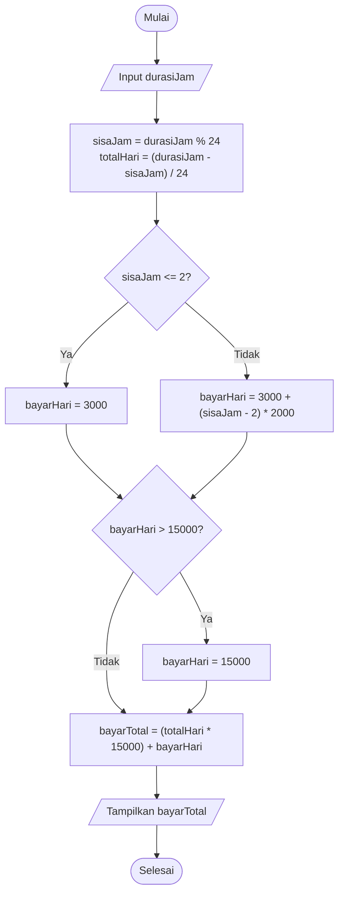
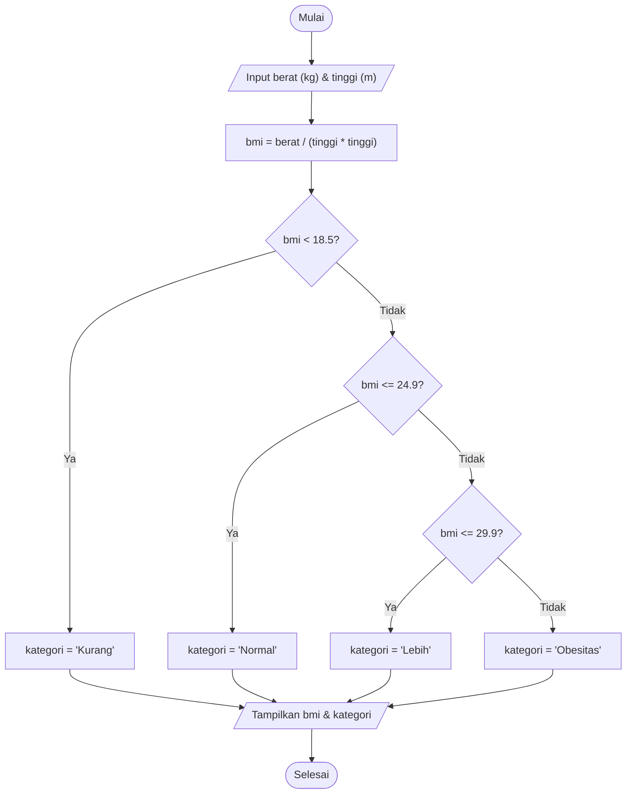
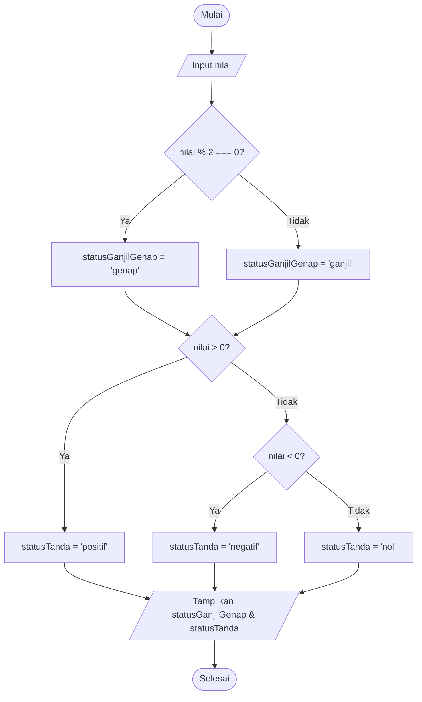

# Flowchart dan Pseudocode Program Percabangan
**Portofolio Hari 4 - JavaScript Dasar dan Pemrograman Terstruktur I**

Dokumen ini memuat perancangan algoritma menggunakan **Pseudocode** dan **Flowchart (Diagram Alir)** untuk program percabangan (*selection*) sesuai modul Hari 4 diklat Junior Web Programmer.

---

## 1. Program 1: Perhitungan Tarif Parkir (`lab2_latihan2.js`)

### Spesifikasi:
- 2 jam pertama: **Rp3.000**
- Tiap jam berikutnya: **Rp2.000 / jam**
- Maksimum per hari (24 jam): **Rp15.000**

### A. Pseudocode
```text
ALGORITMA Hitung_Tarif_Parkir
DEKLARASI:
    durasiJam, sisaJam, totalHari, bayarHari, bayarTotal : Integer
    TARIF_AWAL = 3000
    TARIF_PER_JAM = 2000
    TARIF_MAKS_PER_HARI = 15000

DESKRIPSI:
    MULAI
    BACA durasiJam

    sisaJam = durasiJam MOD 24
    totalHari = (durasiJam - sisaJam) / 24

    JIKA (sisaJam <= 2) MAKA
        bayarHari = TARIF_AWAL
    JIKA TIDAK
        bayarHari = TARIF_AWAL + (sisaJam - 2) * TARIF_PER_JAM
    AKHIR JIKA

    JIKA (bayarHari > TARIF_MAKS_PER_HARI) MAKA
        bayarHari = TARIF_MAKS_PER_HARI
    AKHIR JIKA

    bayarTotal = (totalHari * TARIF_MAKS_PER_HARI) + bayarHari
    TAMPILKAN bayarTotal
    SELESAI
```

### B. Flowchart (Diagram Alir)


---

## 2. Program 2: Penentu Kategori BMI (`lab2_latihan4.js` & `lab4.html`)

### Spesifikasi:
- Rumus BMI: `berat (kg) / (tinggi (m) * tinggi (m))`
- Kategori:
  - BMI < 18.5 : **Kurang**
  - 18.5 $\le$ BMI $\le$ 24.9 : **Normal**
  - 25.0 $\le$ BMI $\le$ 29.9 : **Lebih**
  - BMI $\ge$ 30.0 : **Obesitas**

### A. Pseudocode
```text
ALGORITMA Penentu_Kategori_BMI
DEKLARASI:
    berat, tinggi, bmi : Real
    kategori : String

DESKRIPSI:
    MULAI
    BACA berat (kg)
    BACA tinggi (m)

    bmi = berat / (tinggi * tinggi)

    JIKA (bmi < 18.5) MAKA
        kategori = "Kurang"
    JIKA TIDAK, JIKA (bmi <= 24.9) MAKA
        kategori = "Normal"
    JIKA TIDAK, JIKA (bmi <= 29.9) MAKA
        kategori = "Lebih"
    JIKA TIDAK
        kategori = "Obesitas"
    AKHIR JIKA

    TAMPILKAN bmi, kategori
    SELESAI
```

### B. Flowchart (Diagram Alir)


---

## 3. Program 3: Penentu Bilangan Ganjil/Genap dan Positif/Negatif/Nol (`lab2_latihan1.js`)

### A. Pseudocode
```text
ALGORITMA Penentu_Sifat_Bilangan
DEKLARASI:
    nilai : Integer
    statusGanjilGenap, statusTanda : String

DESKRIPSI:
    MULAI
    BACA nilai

    JIKA (nilai MOD 2 === 0) MAKA
        statusGanjilGenap = "genap"
    JIKA TIDAK
        statusGanjilGenap = "ganjil"
    AKHIR JIKA

    JIKA (nilai > 0) MAKA
        statusTanda = "positif"
    JIKA TIDAK, JIKA (nilai < 0) MAKA
        statusTanda = "negatif"
    JIKA TIDAK
        statusTanda = "nol"
    AKHIR JIKA

    TAMPILKAN statusGanjilGenap, statusTanda
    SELESAI
```

### B. Flowchart (Diagram Alir)


