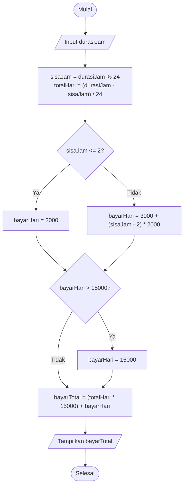
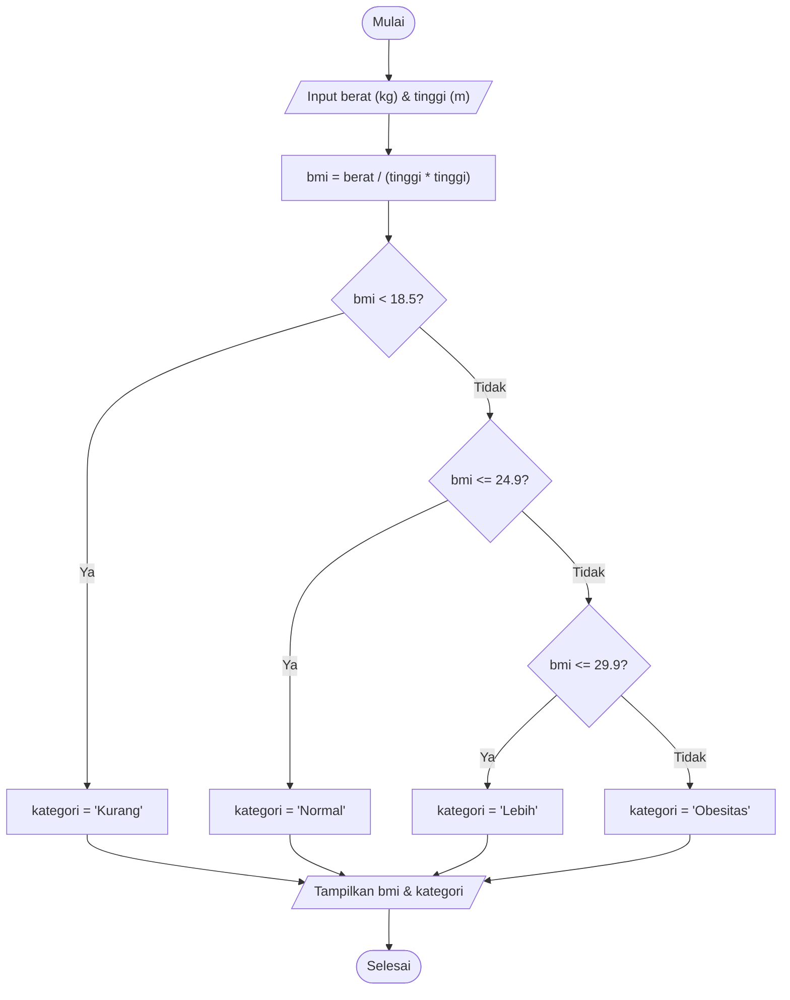

# Portofolio Hari 4 - JavaScript Dasar dan Pemrograman Terstruktur I
**Pelatihan Junior Web Programmer — Balai Diklat Industri Denpasar**  
**Unit Kompetensi**: J.620100.017.02 Mengimplementasikan Pemrograman Terstruktur

---

## 📌 Ringkasan Pemenuhan Bukti Portofolio Hari 4

Dokumen ini disusun untuk merangkum seluruh bukti portofolio Hari 4 sesuai dengan modul pelatihan dan instruksi kerja:
1. **Berkas latihan Lab 1–4** di folder `hari-04-js/`.
2. **`nilai.js` (Aplikasi Konsol Pengolah Nilai)** beserta dokumentasi alur, spesifikasi logika, dan tangkapan layar keluaran terminal.
3. **Tabel Bug Hunt** lengkap dengan klasifikasi 3 jenis kesalahan (*Syntax Error*, *Runtime Error*, *Logic Error*).
4. **Flowchart dan Pseudocode** untuk program percabangan (*Selection*).

---

## 📁 1. Berkas Latihan Lab 1 - 4

Seluruh berkas latihan pada folder [`hari-04-js/`](file:///c:/xampp/htdocs/portofolio-junior-web/hari-04-js/) telah diselesaikan, diuji, dan berfungsi dengan baik:

| Berkas | Keterangan Lab | Lingkungan | Cara Menjalankan |
| :--- | :--- | :---: | :--- |
| [`latihan1.js`](file:///c:/xampp/htdocs/portofolio-junior-web/hari-04-js/latihan1.js) | **Lab 1**: Deklarasi variabel (`nama`, `umur`, `tinggiBadan`, `statusAktif`), pencetakan nilai ekspresi dan `typeof` (`'5' + 3`, `0.1 + 0.2`, `Number('abc')`, `10 / 3`, `10 % 3`, `2 ** 5`, `2 ** 10`), perhitungan luas & keliling lingkaran (`Math.PI`), konversi suhu Celsius ke Fahrenheit, dan perhitungan detik dalam satu hari. | Node.js / Browser | `node latihan1.js` |
| [`lab2_latihan1.js`](file:///c:/xampp/htdocs/portofolio-junior-web/hari-04-js/lab2_latihan1.js) | **Lab 2.1**: Penentu bilangan ganjil/genap dan positif/negatif/nol menggunakan percabangan `if-else`. | Node.js | `node lab2_latihan1.js` |
| [`lab2_latihan2.js`](file:///c:/xampp/htdocs/portofolio-junior-web/hari-04-js/lab2_latihan2.js) | **Lab 2.2**: Perhitungan tarif parkir bertingkat (2 jam pertama Rp3.000, tiap jam berikutnya Rp2.000, maksimum Rp15.000 per hari / 24 jam). | Node.js | `node lab2_latihan2.js` |
| [`lab2_latihan3.js`](file:///c:/xampp/htdocs/portofolio-junior-web/hari-04-js/lab2_latihan3.js) | **Lab 2.3 & Lab 4**: Program kalkulator percabangan `switch` (+, -, *, /) dengan penanganan pembagian dengan nol (*divide by zero*). | Node.js | `node lab2_latihan3.js` |
| [`lab2_latihan4.js`](file:///c:/xampp/htdocs/portofolio-junior-web/hari-04-js/lab2_latihan4.js) | **Lab 2.4**: Penentu kategori BMI (Kurang, Normal, Lebih, Obesitas) dengan perbandingan nilai bertingkat. | Node.js | `node lab2_latihan4.js` |
| [`lab3.js`](file:///c:/xampp/htdocs/portofolio-junior-web/hari-04-js/lab3.js) | **Lab 3 (Contoh Teori)**: Perhitungan Faktorial ($5! = 120$), 10 suku deret Fibonacci, dan bilangan prima sampai 50. | Node.js | `node lab3.js` |
| [`lab3_latihan1.js`](file:///c:/xampp/htdocs/portofolio-junior-web/hari-04-js/lab3_latihan1.js) | **Lab 3 (Tugas Praktik)**: Tabel perkalian $1-10$, pola segitiga bintang, piramida bintang, persegi angka, FizzBuzz $1-50$, jumlah digit angka (`4821` $\rightarrow$ `15`), dan game interaktif tebak angka ($1-100$). | Node.js | `node lab3_latihan1.js` |
| [`lab4.html`](file:///c:/xampp/htdocs/portofolio-junior-web/hari-04-js/lab4.html) | **Lab 4 (Browser DOM)**: Program kalkulator BMI berbasis antarmuka HTML dengan manipulasi DOM untuk input dan pembacaan hasil. | Browser | Buka file di browser / Live Server |
| [`bug-js.js`](file:///c:/xampp/htdocs/portofolio-junior-web/hari-04-js/bug-js.js) | **Bug Hunt**: Kode perbaikan dari 8 kasus kesalahan program beserta penjelasan klasifikasi error. | Node.js | `node bug-js.js` |
| [`nilai.js`](file:///c:/xampp/htdocs/portofolio-junior-web/hari-04-js/nilai.js) | **PBL Proyek Utama**: Aplikasi konsol interaktif Pengolah Nilai Siswa (CRUD nilai, statistik, peringkat terurut, dan histogram). | Node.js | `node nilai.js` |
| [`pseudocode.txt`](file:///c:/xampp/htdocs/portofolio-junior-web/hari-04-js/pseudocode.txt) | **Dokumentasi Algoritma**: Notasi pseudocode terstruktur untuk seluruh latihan percabangan. | Teks | Dibaca langsung |
| [`FLOWCHART_DAN_PSEUDOCODE.md`](file:///c:/xampp/htdocs/portofolio-junior-web/hari-04-js/FLOWCHART_DAN_PSEUDOCODE.md) | **Visualisasi Algoritma**: Diagram alir (Flowchart Mermaid) dan pseudocode komprehensif. | Markdown | Dibaca di editor / GitHub |

> **Catatan Alur Kalkulator:**  
> Program kalkulator sederhana dengan `switch` (+, -, *, /) serta penanganan pembagian dengan nol telah dibuat dan terintegrasi pada [`lab2_latihan3.js`](file:///c:/xampp/htdocs/portofolio-junior-web/hari-04-js/lab2_latihan3.js) untuk memenuhi kebutuhan kalkulator percabangan.

---

## 🎯 2. PBL: Aplikasi Konsol Pengolah Nilai (`nilai.js`)

### A. Deskripsi & Studi Kasus
Guru membutuhkan aplikasi berbasis konsol terminal (Node.js) untuk mencatat daftar nilai siswa satu kelas, menghitung ringkasan statistik nilai, serta menampilkan predikat kelulusan siswa.

### B. Spesifikasi & Kepatuhan Persyaratan Modul
1. **Menu Berulang**: Aplikasi berjalan dalam perulangan `while (jalan)` interaktif berbasis `readline/promises` sampai pengguna memilih menu `4` (Keluar).
2. **Validasi Input Ketat**:
   - Nama siswa divalidasi tidak boleh kosong (`!nama`).
   - Nilai siswa divalidasi harus berupa angka antara 0 hingga 100 (`Number.isNaN(nilai) || nilai < NILAI_MIN || nilai > NILAI_MAKS`).
   - Pilihan menu di luar rentang 1–4 ditangani oleh blok `default`.
3. **Statistik Nilai Kelas**:
   - Menghitung rata-rata kelas berformat dua desimal (`rataRata.toFixed(2)`).
   - Menemukan nilai tertinggi dan terendah menggunakan perulangan.
   - Menghitung jumlah siswa yang **Lulus** ($\ge 70$) dan **Tidak Lulus** ($< 70$).
4. **Skala Grade Standar**:
   - **Grade A**: Nilai $\ge 85$ (Lulus)
   - **Grade B**: Nilai $70 - 84$ (Lulus)
   - **Grade C**: Nilai $55 - 69$ (Tidak lulus)
   - **Grade D**: Nilai $< 55$ (Tidak lulus)
5. **Kebersihan Kode (Clean Code)**:
   - Konstanta bernama tanpa *magic numbers* (`NILAI_MIN`, `NILAI_MAKS`, `BATAS_LULUS`, `BATAS_GRADE_A`, `BATAS_GRADE_B`, `BATAS_GRADE_C`).
   - Penamaan *camelCase*, indentasi 2 spasi konsisten, dan komentar penjelas.
6. **Fitur Tambahan**:
   - **Bubble Sort Manual**: Pada Menu 3, siswa diurutkan secara otomatis dari nilai tertinggi ke terendah sebelum ditampilkan.
   - **Histogram Grade**: Pada Menu 2, menampilkan sebaran frekuensi jumlah siswa untuk setiap grade (A, B, C, D).

### C. Cara Menjalankan
Buka terminal pada direktori `hari-04-js/` dan jalankan perintah:
```bash
node nilai.js
```

---

### D. Tangkapan Layar Keluaran Terminal (Terminal Output)

Berikut adalah rekaman interaksi lengkap saat menjalankan `nilai.js`:

```text
$ node nilai.js

===== PENGOLAH NILAI =====
1. Input nilai siswa
2. Tampilkan statistik
3. Tampilkan predikat per siswa
4. Keluar
Pilih menu (1-4): 1
Nama siswa: Budi
Nilai (0-100): 90
Data siswa berhasil ditambahkan.

===== PENGOLAH NILAI =====
1. Input nilai siswa
2. Tampilkan statistik
3. Tampilkan predikat per siswa
4. Keluar
Pilih menu (1-4): 1
Nama siswa: Siti
Nilai (0-100): 75
Data siswa berhasil ditambahkan.

===== PENGOLAH NILAI =====
1. Input nilai siswa
2. Tampilkan statistik
3. Tampilkan predikat per siswa
4. Keluar
Pilih menu (1-4): 1
Nama siswa: Citra
Nilai (0-100): 60
Data siswa berhasil ditambahkan.

===== PENGOLAH NILAI =====
1. Input nilai siswa
2. Tampilkan statistik
3. Tampilkan predikat per siswa
4. Keluar
Pilih menu (1-4): 1
Nama siswa: Doni
Nilai (0-100): 50
Data siswa berhasil ditambahkan.

===== PENGOLAH NILAI =====
1. Input nilai siswa
2. Tampilkan statistik
3. Tampilkan predikat per siswa
4. Keluar
Pilih menu (1-4): 2
Rata-rata: 68.75
Nilai tertinggi: 90
Nilai terendah: 50
Jumlah lulus: 2
Jumlah tidak lulus: 2
Histogram per grade:
Grade A: 1
Grade B: 1
Grade C: 1
Grade D: 1

===== PENGOLAH NILAI =====
1. Input nilai siswa
2. Tampilkan statistik
3. Tampilkan predikat per siswa
4. Keluar
Pilih menu (1-4): 3

=== PREDIKAT SISWA (TERURUT NILAI TERTINGGI) ===
1. Budi: 90 (Grade A) - Lulus
2. Siti: 75 (Grade B) - Lulus
3. Citra: 60 (Grade C) - Tidak lulus
4. Doni: 50 (Grade D) - Tidak lulus

===== PENGOLAH NILAI =====
1. Input nilai siswa
2. Tampilkan statistik
3. Tampilkan predikat per siswa
4. Keluar
Pilih menu (1-4): 4
Terima kasih.
```

---

## 🐛 3. Tabel Bug Hunt Hari 4 (Klasifikasi Jenis Error)

Tabel berikut mengklasifikasikan 8 kasus kesalahan program dari modul latihan ke dalam kategori **Syntax Error**, **Runtime Error**, atau **Logic Error** beserta perbaikannya:

| No | Kode Bermasalah | Klasifikasi Jenis Error | Akar Penyebab Kesalahan | Kode Perbaikan |
| :---: | :--- | :---: | :--- | :--- |
| **1** | `if (nilai = 70)` | **Logic Error** | Operator `=` adalah penugasan (*assignment*), bukan perbandingan. Ekspresi ini selalu mengembalikan `70` (*truthy*) dan mengubah variabel `nilai`. | `if (nilai === 70)` |
| **2** | `for (let i = 1; i <= 10; i--)` | **Logic Error** *(Infinite Loop)* | Operasi *decrement* `i--` menyebabkan nilai `i` terus berkurang, sehingga kondisi `i <= 10` selalu benar dan perulangan tidak pernah berhenti. | `for (let i = 1; i <= 10; i++)` |
| **3** | `for (let i = 0; i <= daftar.length; i++)` | **Logic Error** *(Off-by-One)* | Indeks array berakhir di `length - 1`. Tanda `<=` menyebabkan iterasi terakhir mengakses indeks `daftar[daftar.length]` yang bernilai `undefined`. | `for (let i = 0; i < daftar.length; i++)` |
| **4** | `const a = prompt('A');`<br>`const b = prompt('B');`<br>`console.log(a + b);` | **Logic Error** *(String Concatenation)* | Fungsi `prompt()` mengembalikan string. Operator `+` pada string melakukan penggabungan teks (`'5' + '3' = '53'`), bukan penjumlahan matematis. | `const a = Number(prompt('A'));`<br>`const b = Number(prompt('B'));`<br>`console.log(a + b);` |
| **5** | `elseif (x > 5)` | **Syntax Error** | JavaScript tidak memiliki kata kunci gabung `elseif`. Mesin JS gagal mengurai struktur kode (*SyntaxError*). | `else if (x > 5)` |
| **6** | `const total = 0;`<br>`total += 5;` | **Runtime Error** *(TypeError)* | Variabel `const` bersifat konstan dan dilarang untuk diubah nilainya (*Assignment to constant variable*). | `let total = 0;`<br>`total += 5;` |
| **7** | `console.log(jumlahPeserta)`<br>*(sebelum dideklarasikan)* | **Runtime Error** *(ReferenceError)* | Variabel diakses sebelum inisialisasinya dijalankan (*Temporal Dead Zone*). | Deklarasikan variabel terlebih dahulu:<br>`let jumlahPeserta = 30;`<br>`console.log(jumlahPeserta);` |
| **8** | `console.log('Halo);` | **Syntax Error** *(Unterminated String)* | Tanda petik pembuka `'` tidak memiliki pasangan tanda petik penutup, sehingga gagal saat tahap *parsing*. | `console.log('Halo');` |

> Kode implementasi pengujian perbaikan tersimpan pada [`bug-js.js`](file:///c:/xampp/htdocs/portofolio-junior-web/hari-04-js/bug-js.js).

---

## 📊 4. Flowchart dan Pseudocode Dua Program Percabangan

Dokumentasi diagram alir lengkap dan teks pseudocode terstruktur disajikan pada berkas:
- [`FLOWCHART_DAN_PSEUDOCODE.md`](file:///c:/xampp/htdocs/portofolio-junior-web/hari-04-js/FLOWCHART_DAN_PSEUDOCODE.md)
- [`pseudocode.txt`](file:///c:/xampp/htdocs/portofolio-junior-web/hari-04-js/pseudocode.txt)

### Diagram Alir 1: Perhitungan Tarif Parkir (`lab2_latihan2.js`)


### Diagram Alir 2: Penentu Kategori BMI (`lab2_latihan4.js` & `lab4.html`)


---


