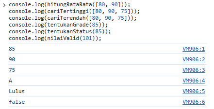
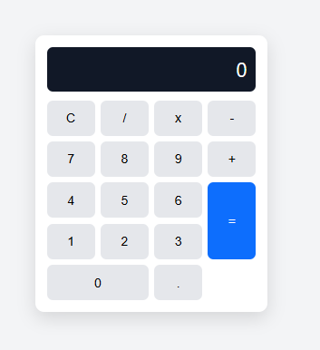
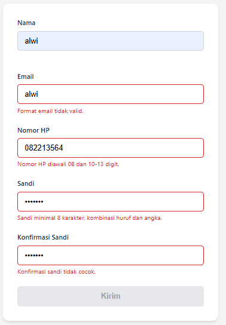
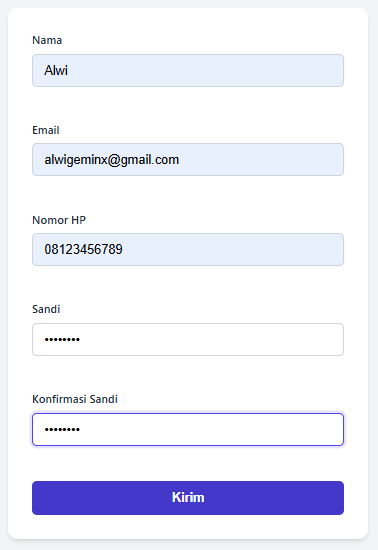
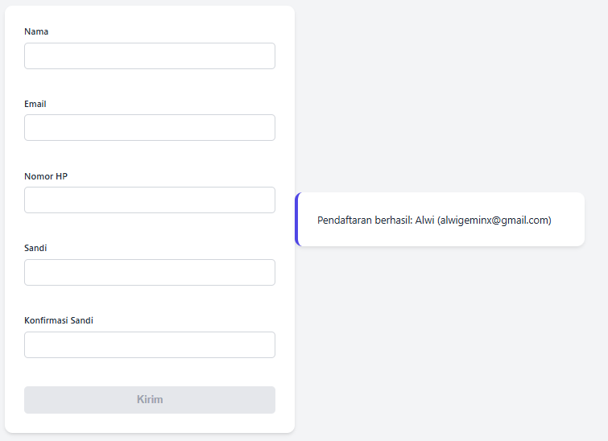

# Portofolio Hari 5 - Fungsi, Array, DOM, dan Modularisasi (Proyek 2)
**Pelatihan Junior Web Programmer — Balai Diklat Industri Denpasar**  
**Unit Kompetensi**: J.620100.017.02 Mengimplementasikan Pemrograman Terstruktur (Lanjutan)

---

## 📌 Ringkasan Pemenuhan Bukti Portofolio Hari 5

Berdasarkan modul pembelajaran Hari 5, terdapat 3 bukti portofolio utama yang disajikan dalam dokumen ini:
1. **`nilai-fungsi.js` dengan pengujian `console.assert`** (Lab 1: Refactor Pengolah Nilai ke Fungsi Murni dan JSDoc).
2. **Folder `proyek-2-kalkulator/` (Dua Aplikasi: Kalkulator & Form Validator)** dan panduan pemakaian dengan tautan tangkapan layar `.png`.
3. **Tabel Bug Hunt Hari 5 dan Daftar Kasus Tepi (*Edge Cases*) yang Diuji**.

---

## 📁 1. Struktur Berkas Hari 5

Seluruh berkas latihan dan proyek telah tersusun secara terstruktur di dalam repositori:

```text
hari-05-js-fungsi2/
├── nilaifungsi.js              # Lab 1: Implementasi fungsi murni & pengujian console.assert
├── fungsinilai.js              # Lab 1: Program konsol Pengolah Nilai modular ber-JSDoc
├── arrayobject.js              # Lab 2: Pemrosesan array of object (filter, map, reduce, find, sort)
├── listtugas.html              # Lab 3: Manipulasi DOM, to-do list, dan event listener
├── listtugas2.html             # Lab 3: To-do list dengan tantangan classList toggle & batasan teks
├── index.html                  # Lab 4: Pengujian ES Module import/export matematika
├── js/
│   ├── app.js                  # Modul penghubung DOM Lab 4
│   ├── apps.js                 # Variasi modul DOM Lab 4
│   ├── matematika.js           # Modul ekspor fungsi matematika murni
│   └── operasi.js              # Modul ekspor operasi dasar
├── project-2-kalkulator/        # PBL Hari 5: Proyek 2 (Kalkulator & Form Validator)
│   ├── kalkulator/
│   │   ├── index.html          # Antarmuka kalkulator berbasis CSS Grid
│   │   ├── css/style.css       # Desain responsif display kalkulator
│   │   └── js/
│   │       ├── operasi.js      # Logika perhitungan matematika murni (export)
│   │       └── app.js          # Pengendali DOM, event delegation, dan penanganan error
│   ├── validator/
│   │   ├── index.html          # Form pendaftaran akun dengan atribut aksesibilitas
│   │   ├── css/style.css       # Desain form dan indikator pesan validasi
│   │   └── js/
│   │       ├── aturan.js       # Logika aturan validasi regex & panjang string (export)
│   │       └── app.js          # Pengendali event input, validasi submit, & ringkasan
│   └── README.md               # Dokumentasi khusus Proyek 2 Kalkulator & Validator
└── README.md                   # Dokumentasi Utama Bukti Portofolio Hari 5
```

---

## 🧪 2. Bukti 1: `nilai-fungsi.js` dengan Pengujian `console.assert`

### A. Modularisasi Fungsi Murni
Program Pengolah Nilai dari Hari 4 telah dirombak (*refactor*) menjadi fungsi-fungsi murni (*pure functions*) yang modular, mandiri (tidak bergantung pada variabel global), memiliki tanggung jawab tunggal (*Single Responsibility Principle*), dan dilengkapi dokumentasi standar **JSDoc**:

1. **`hitungRataRata(daftar)`**:
   - Menghitung nilai rata-rata dari elemen array angka menggunakan method `reduce()`.
   - Mengembalikan nilai `0` jika array kosong untuk mencegah hasil `NaN`.
2. **`cariTertinggi(daftar)`**:
   - Menemukan nilai maksimum menggunakan `Math.max(...daftar)`.
   - Mengembalikan `null` jika array kosong.
3. **`cariTerendah(daftar)`**:
   - Menemukan nilai minimum menggunakan `Math.min(...daftar)`.
   - Mengembalikan `null` jika array kosong.
4. **`tentukanGrade(nilai)`**:
   - Menentukan grade huruf berdasarkan skala baku: Grade A ($\ge 85$), Grade B ($70-84$), Grade C ($55-69$), dan Grade D ($< 55$).
5. **`tentukanStatus(nilai)`**:
   - Menentukan status `'Lulus'` jika nilai $\ge 70$, atau `'Tidak lulus'` jika nilai $< 70$.
6. **`nilaiValid(nilai)`**:
   - Memvalidasi tipe numerik berhingga dalam rentang nilai valid ($0 \le \text{nilai} \le 100$) menggunakan `Number.isFinite(nilai)`.
7. **Prosedur `tampilMenu()` & `tampilSiswa(nama, nilai)`**:
   - Prosedur pendukung antarmuka konsol untuk menampilkan menu dan baris data siswa.

### B. Pengujian Otomatis dengan `console.assert`
Pengujian unit sederhana dijalankan untuk memastikan setiap fungsi bekerja sesuai spesifikasi:

```javascript
console.assert(hitungRataRata([80, 90]) === 85, 'rata-rata 80,90 harus 85');
console.assert(hitungRataRata([]) === 0, 'rata-rata array kosong harus 0');
console.assert(tentukanGrade(85) === 'A', 'nilai 85 harus A');
console.assert(tentukanGrade(69) === 'C', 'nilai 69 harus C');
console.assert(nilaiValid(101) === false, '101 tidak valid');
console.assert(nilaiValid(-1) === false, '-1 tidak valid');
console.assert(nilaiValid('abc') === false, 'abc tidak valid');
```

> **Catatan Pengujian:** `console.assert` hanya akan menampilkan pesan galat di konsol jika kondisi yang diuji bernilai `false`. Apabila seluruh pengujian benar (*pass*), konsol tidak akan mencetak pesan kesalahan apa pun.

### C. Tangkapan Layar Pengujian `console.assert`
Berikut adalah tangkapan layar eksekusi pengujian pada terminal / konsol:



---

## 🚀 3. Bukti 2: Proyek 2 - Kalkulator dan Form Validator

Proyek 2 terdiri dari dua aplikasi web modular yang menerapkan pemisahan logika murni (*business logic*) dari antarmuka pengguna (*DOM & event*).

---

### Bagian A: Kalkulator Modular

#### 1. Fitur & Spesifikasi
- **Pemisahan Modul**: Logika perhitungan dipisahkan pada `operasi.js` (`tambah`, `kurang`, `kali`, `bagi`, `hitung`), sedangkan manipulasi DOM berada di `app.js`.
- **Antarmuka CSS Grid**: Tombol tersusun rapi dengan CSS Grid 4 kolom, tombol `=` memanjang 2 baris, dan tombol `0` memanjang 2 kolom.
- **Event Delegation**: Menggunakan satu pendengar `click` pada elemen induk `#papan` dengan `event.target.closest('button')`.
- **Akurasi Pecahan**: Menyelesaikan masalah floating point $0.1 + 0.2$ sehingga tampil tepat `0.3` melalui `hasil.toFixed(10)` yang dikonversi kembali ke `Number`.
- **Pencegahan Pembagian Nol**: Jika membagi dengan angka `0`, fungsi melempar `Error('Tidak bisa dibagi nol')` dan ditangkap dengan blok `try...catch` untuk menampilkan pesan ramah pada layar, bukan `Infinity`. Tombol `C` mengembalikan layar ke kondisi awal `0`.

#### 2. Tangkapan Layar Aplikasi Kalkulator

* **Tampilan Kalkulator Normal:**
  

* **Tampilan Kasus Tepi (Pembagian dengan Nol):**
  

---

### Bagian B: Form Validator Modular

#### 1. Fitur & Spesifikasi
- **Pemisahan Modul**: Aturan validasi didefinisikan secara deklaratif di `aturan.js` dan diimpor ke `app.js`.
- **Validasi Real-time**: Event `input` memvalidasi setiap ketukan tombol pengguna dan event `submit` memverifikasi seluruh isian sebelum dikirim.
- **Aturan Validasi Lengkap**:
  - **Nama**: Wajib diisi, minimal 3 karakter (`nilai.trim().length >= 3`).
  - **Email**: Pola regex email standar `/^[^\s@]+@[^\s@]+\.[^\s@]+$/`.
  - **Nomor HP**: Format Indonesia diawali `08` dengan panjang 10–13 digit numerik `/^08[0-9]{8,11}$/`.
  - **Kata Sandi**: Minimal 8 karakter, wajib kombinasi huruf dan angka (`/[0-9]/` dan `/[A-Za-z]/`).
  - **Konfirmasi Sandi**: Harus sama persis dengan kolom kata sandi.
- **Aksesibilitas (A11y)**:
  - Menggunakan atribut `aria-describedby` yang terhubung ke elemen pesan galat.
  - Atribut `aria-invalid='true'` ditambahkan saat input salah.
  - Wadah pesan galat menggunakan `aria-live='polite'` untuk pembaca layar (*screen reader*).
- **Proteksi Pengiriman & Anti-XSS**:
  - Tombol `Kirim` dalam kondisi nonaktif (`disabled`) selama masih ada input yang belum valid.
  - Data pendaftaran ditampilkan ke elemen ringkasan menggunakan `textContent` untuk mencegah celah keamanan **XSS (Cross-Site Scripting)**.

#### 2. Tangkapan Layar Aplikasi Form Validator

* **Tampilan Form Saat Input Belum Valid (Pesan Galat & Tombol Nonaktif):**
  

* **Tampilan Form Sukses (Tombol Aktif & Muncul Ringkasan Data):**
  
  

---

## 🐛 4. Bukti 3: Tabel Bug Hunt Hari 5

Tabel klasifikasi 8 kesalahan program pada modul Hari 5 mencakup gejala yang dialami, jenis kesalahan (*Syntax*, *Runtime*, atau *Logic Error*), dan solusi perbaikannya:

| No | Kode Bermasalah | Gejala yang Terjadi | Jenis Error | Penjelasan & Solusi Perbaikan |
| :---: | :--- | :--- | :---: | :--- |
| **1** | Fungsi tanpa `return` lalu hasil pemanggilannya dipakai | Hasil kembalian bernilai `undefined` | **Logic Error** | Fungsi yang menghitung nilai wajib menggunakan pernyataan `return` untuk mengembalikan hasil ke pemanggil. |
| **2** | `hitungRataRata(daftar)` tidak memeriksa kondisi array kosong | Menghasilkan nilai `NaN` atau `0/0` | **Logic Error** | Tambahkan pengecekan kasus tepi di awal fungsi: `if (daftar.length === 0) return 0;`. |
| **3** | `document.getElementById('Tombol')` padahal atribut `id='tombol'` | Variabel bernilai `null`, memicu `TypeError: Cannot read properties of null` saat `addEventListener` | **Runtime Error** | Pencarian ID pada DOM bersifat peka huruf besar-kecil (*case sensitive*). Samakan penulisan ID menjadi `'tombol'`. |
| **4** | Tag `<script>` diletakkan di `<head>` tanpa atribut `defer` | Elemen HTML belum ada saat dicari oleh skrip (`null`) | **Runtime Error** | Pindahkan tag `<script>` ke sebelum penutup `</body>` atau tambahkan atribut `defer` pada tag script di `<head>`. |
| **5** | Event submit form tidak memanggil `event.preventDefault()` | Halaman langsung termuat ulang (*refresh*) sehingga validasi JS batal | **Logic Error** | Tambahkan `event.preventDefault();` pada baris pertama pendengar event `submit` untuk membatalkan perilaku bawaan browser. |
| **6** | `daftar.sort()` langsung dipanggil pada array angka | Urutan angka salah (contoh: `[10, 2, 5]` karena diurutkan secara string alfabetis) | **Logic Error** | Berikan fungsi pembanding numerik pada sort: `daftar.sort((a, b) => a - b)`. |
| **7** | `for (var i = 0; ...)` dengan fungsi callback penutup (*closure*) | Seluruh event listener menggunakan nilai `i` yang terakhir | **Logic Error** *(Scope)* | Ganti kata kunci `var` dengan `let` agar variabel memiliki cakupan blok (*block scope*) unik di setiap iterasi perulangan. |
| **8** | Mengisi data pengguna langsung via `el.innerHTML = inputPengguna` | Membuka celah keamanan berbahaya **Cross-Site Scripting (XSS)** | **Security / Logic Vulnerability** | Gunakan properti `el.textContent = inputPengguna` agar karakter teks di-escape secara aman oleh browser. |

---

## 🔍 5. Daftar Kasus Tepi (*Edge Cases*) yang Diuji

Pengujian kasus tepi dilakukan untuk menjamin kestabilan dan keandalan sistem terhadap berbagai variasi input:

### A. Kasus Tepi pada Kalkulator
1. **Presisi Desimal Floating Point**:
   - *Input*: `0.1 + 0.2`
   - *Ekspektasi*: Menghasilkan `0.3`, bukan `0.30000000000000004`.
   - *Hasil*: **LOLOS** (diformat dengan `toFixed(10)` dan dikembalikan ke tipe `Number`).
2. **Pembagian dengan Angka Nol**:
   - *Input*: `5 / 0`
   - *Ekspektasi*: Tidak menghasilkan `Infinity`, melainkan melempar galat yang menampilkan pesan teks `"Tidak bisa dibagi nol"`.
   - *Hasil*: **LOLOS** (ditangani oleh blok `try...catch`).
3. **Pemulihan Layar dengan Tombol Hapus (`C`)**:
   - *Input*: Setelah pesan error muncul, pengguna menekan tombol `C`.
   - *Ekspektasi*: Layar kembali bersih menjadi angka `0` dan status siap untuk perhitungan baru.
   - *Hasil*: **LOLOS** (fungsi `bersihkan()` mereset seluruh variabel status).
4. **Input Titik Desimal Berulang**:
   - *Input*: `3.1.4`
   - *Ekspektasi*: Titik desimal kedua diabaikan sehingga angka tetap `3.14`.
   - *Hasil*: **LOLOS** (dijaga oleh kondisi `layar.includes('.')`).
5. **Angka Diawali Titik Desimal Langsung**:
   - *Input*: Tekan `.` setelah layar direset.
   - *Ekspektasi*: Tampil otomatis `0.` bukan hanya `.`.
   - *Hasil*: **LOLOS**.
6. **Pergantian Operator Berturut-turut**:
   - *Input*: Menekan `+` lalu langsung menekan `*`.
   - *Ekspektasi*: Operator terakhir yang aktif menggantikan operator sebelumnya tanpa merusak kalkulasi.
   - *Hasil*: **LOLOS**.
7. **Tampilan Angka Sangat Panjang**:
   - *Input*: `123456789012345`
   - *Ekspektasi*: Layar tidak meluap keluar kotak kalkulator (*overflow-x: auto*).
   - *Hasil*: **LOLOS**.

---

### B. Kasus Tepi pada Form Validator
1. **Nama Hanya Berisi Karakter Spasi (*Whitespace*)**:
   - *Input*: `"   "`
   - *Ekspektasi*: Ditolak dengan pesan *"Nama minimal 3 karakter."*
   - *Hasil*: **LOLOS** (menggunakan `.trim().length >= 3`).
2. **Email Tanpa Karakter `@` atau Tanpa Domain**:
   - *Input*: `budi.gmail.com` atau `budi@com`
   - *Ekspektasi*: Ditolak dengan pesan *"Format email tidak valid."*
   - *Hasil*: **LOLOS** (validasi regex komprehensif).
3. **Nomor HP Bukan Format Indonesia atau Kurang Digit**:
   - *Input*: `021123456` (kode area) atau `08123` (hanya 5 digit)
   - *Ekspektasi*: Ditolak dengan pesan *"Nomor HP diawali 08 dan 10-13 digit."*
   - *Hasil*: **LOLOS** (regex `/^08[0-9]{8,11}$/`).
4. **Kata Sandi Panjang Namun Hanya Huruf Saja / Angka Saja**:
   - *Input*: `abcdefgh` (tanpa angka) atau `12345678` (tanpa huruf)
   - *Ekspektasi*: Ditolak dengan pesan *"Sandi minimal 8 karakter, kombinasi huruf dan angka."*
   - *Hasil*: **LOLOS** (pengujian ganda regex huruf dan angka).
5. **Konfirmasi Sandi Berbeda Satu Karakter**:
   - *Input*: Sandi `Rahasia1`, Konfirmasi `rahasia1` (*case-sensitive*)
   - *Ekspektasi*: Ditolak dengan pesan *"Konfirmasi sandi tidak cocok."*
   - *Hasil*: **LOLOS** (perbandingan ketat `===`).
6. **Penyisipan Kode Berbahaya (*XSS Injection*)**:
   - *Input*: Nama diisi `<script>alert('xss')</script>`
   - *Ekspektasi*: Skrip tidak dieksekusi oleh browser saat ringkasan ditampilkan.
   - *Hasil*: **LOLOS** (menggunakan `textContent` sehingga tag HTML diperlakukan sebagai teks biasa).

---

## 📊 6. Rubrik Penilaian Proyek 2 (100 Poin)

| Aspek Penilaian | Bobot | Indikator Ketercapaian | Status |
| :--- | :---: | :--- | :---: |
| **Fungsionalitas** | 30% | Kalkulator dan Form Validator berjalan lancar sesuai seluruh butir spesifikasi. | **TERPENUHI** |
| **Modularisasi Fungsi & Berkas** | 25% | Logika bisnis dipisah penuh dari manipulasi UI/DOM menggunakan modul ES (`export`/`import`). Fungsi bersifat *single-responsibility*. | **TERPENUHI** |
| **Penanganan Kasus Tepi** | 20% | Mampu menangani pembagian dengan nol, string kosong, desimal presisi, regex nomor HP/email, dan sanitasi input. | **TERPENUHI** |
| **Kebersihan Kode (Clean Code)** | 15% | Penamaan *camelCase*, indentasi 2 spasi konsisten, anotasi JSDoc, tanpa duplikasi kode (*DRY*), dan tanpa atribut event inline. | **TERPENUHI** |
| **Dokumentasi & Git** | 10% | Menyediakan berkas README informatif, dokumentasi kasus tepi, tautan tangkapan layar `.png`, dan riwayat commit teratur. | **TERPENUHI** |

---

## ✅ Ceklis Kelulusan Portofolio Hari 5

- [x] Pengolah Nilai versi fungsi (`nilaifungsi.js` / `fungsinilai.js`) lolos pengujian `console.assert`.
- [x] Fungsi publik dilengkapi dokumentasi JSDoc standar.
- [x] Kalkulator menangani pembagian dengan nol dan kasus tepi presisi angka.
- [x] Form Validator memvalidasi *real-time*, menonaktifkan tombol kirim, dan aman dari XSS.
- [x] Kode terorganisasi modular dalam berkas-berkas terpisah.
- [x] Tabel Bug Hunt selesai diklasifikasikan dengan 8 butir lengkap.
- [x] Seluruh tautan tangkapan layar disiapkan dalam format `.png`.

