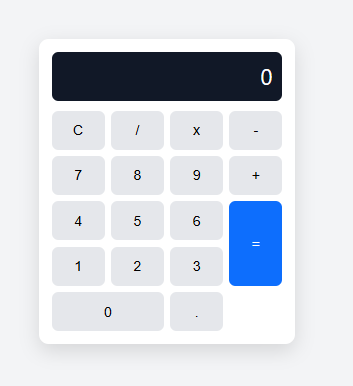
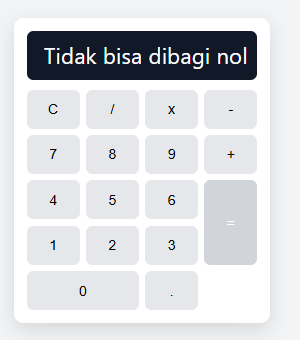
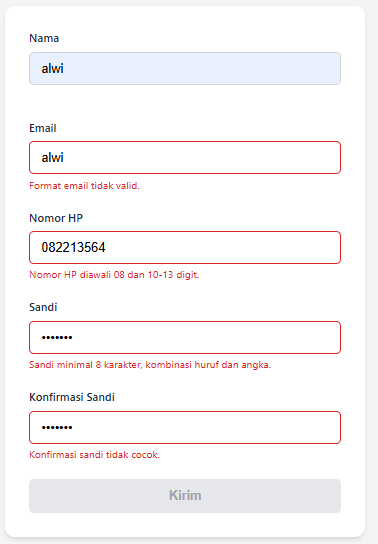
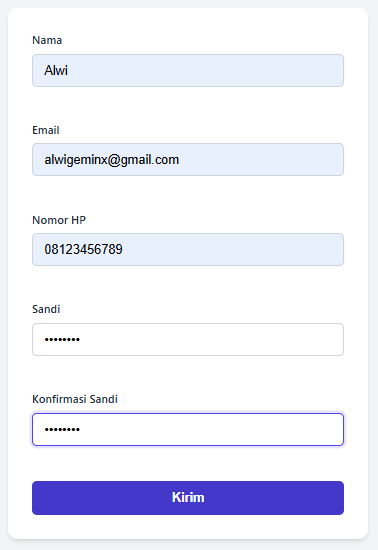
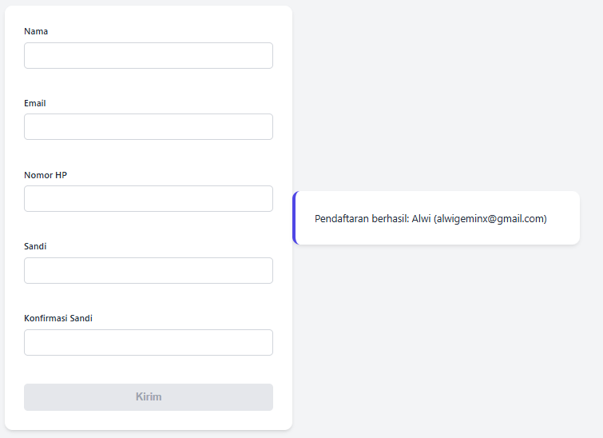

# Proyek 2: Kalkulator dan Form Validator Modular

Proyek ini merupakan implementasi **Project-Based Learning (PBL)** Hari ke-5 pada Pelatihan Junior Web Programmer (BDI Denpasar) yang berfokus pada:
1. Pemisahan logika murni (*business logic*) dan antarmuka pengguna (*DOM & event*).
2. Modularitas menggunakan standar JavaScript ES Module (`export` dan `import`).
3. Penanganan galat (*error handling*), penanganan kasus tepi (*edge cases*), dan keamanan dari celah XSS.
4. Aksesibilitas form (*accessibility / a11y*).

---

## 📁 Struktur Berkas

```text
project-2-kalkulator/
├── kalkulator/
│   ├── index.html          # Antarmuka kalkulator (CSS Grid)
│   ├── css/
│   │   └── style.css       # Styling kalkulator dan tombol operasi
│   └── js/
│       ├── operasi.js      # Modul logika perhitungan matematika murni
│       └── app.js          # Pengendali DOM dan event delegation
├── validator/
│   ├── index.html          # Antarmuka form registrasi
│   ├── css/
│   │   └── style.css       # Styling form dan indikator pesan galat
│   └── js/
│       ├── aturan.js       # Modul aturan validasi regex & panjang string
│       └── app.js          # Pengendali event input dan proteksi submit
└── README.md               # Dokumentasi Proyek 2
```

---

## 🧮 1. Aplikasi Kalkulator

### A. Fitur Utama
- **CSS Grid Layout**: Tata letak tombol kalkulator 4 kolom yang responsif dengan tombol `=` (merentang 2 baris) dan tombol `0` (merentang 2 kolom).
- **Event Delegation**: Menggunakan satu event listener `click` pada container tombol (`#papan`) dan mendeteksi target tombol melalui `event.target.closest('button')`.
- **Akurasi Pecahan**: Mencegah galat presisi floating point JavaScript (misal: `0.1 + 0.2 = 0.30000000000000004`) menggunakan fungsi `toFixed(10)` yang dikembalikan ke tipe `Number`.
- **Penanganan Pembagian dengan Nol**: Fungsi `bagi` melempar `Error('Tidak bisa dibagi nol')` dan ditangkap dengan blok `try...catch` untuk menampilkan pesan kesalahan yang ramah pada layar.
- **Tombol Reset (`C`)**: Mengembalikan kalkulator ke kondisi awal (`0`).

### B. Tangkapan Layar
* **Tampilan Normal:**  
  

* **Tampilan Kasus Pembagian Nol:**  
  

---

## 📝 2. Aplikasi Form Validator

### A. Fitur Utama
- **Modularitas Aturan**: Aturan validasi didefinisikan secara deklaratif di `aturan.js` dan diuji secara independen.
- **Validasi Real-time**: Menggunakan event `input` untuk memeriksa keabsahan data setiap kali pengguna mengetik.
- **Aturan Validasi Lengkap**:
  - **Nama**: Wajib diisi, minimal 3 karakter (setelah di-`trim`).
  - **Email**: Format email valid sesuai pola standar regex (`/^[^\s@]+@[^\s@]+\.[^\s@]+$/`).
  - **Nomor HP**: Format nomor telepon Indonesia diawali `08` dengan 10–13 digit (`/^08[0-9]{8,11}$/`).
  - **Kata Sandi**: Minimal 8 karakter, wajib kombinasi huruf dan angka (`/[0-9]/` dan `/[A-Za-z]/`).
  - **Konfirmasi Sandi**: Harus identik dengan kolom kata sandi.
- **Aksesibilitas (A11y)**:
  - Menggunakan atribut `aria-invalid` saat field bermasalah.
  - Menghubungkan kolom input ke pesan galat dengan `aria-describedby`.
  - Pesan galat menggunakan `aria-live="polite"`.
- **Keamanan Anti-XSS**:
  - Menggunakan `textContent` saat menampilkan data ringkasan hasil submit untuk mengamankan aplikasi dari injeksi skrip HTML/JavaScript.
  - Tombol submit tetap berstatus `disabled` selama form belum seluruhnya valid.

### B. Tangkapan Layar
* **Tampilan Form Galat / Validasi Gagal:**  
  

* **Tampilan Form Sukses:**  
  
  

---

## 🚀 Cara Menjalankan

Karena proyek ini menggunakan fitur **ES Module** (`import` / `export`), berkas HTML harus dijalankan melalui server lokal (bukan protokol `file://`):

1. Pastikan server web lokal seperti **XAMPP (Apache)** atau ekstensi **Live Server** (VS Code) aktif.
2. Akses aplikasi kalkulator melalui browser:
   ```text
   http://localhost/portofolio-junior-web/hari-05-js-fungsi2/project-2-kalkulator/kalkulator/
   ```
3. Akses aplikasi form validator melalui browser:
   ```text
   http://localhost/portofolio-junior-web/hari-05-js-fungsi2/project-2-kalkulator/validator/
   ```

