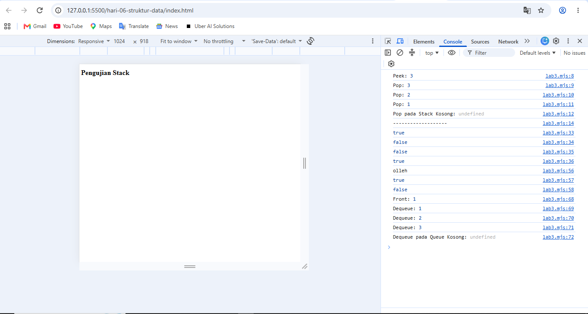
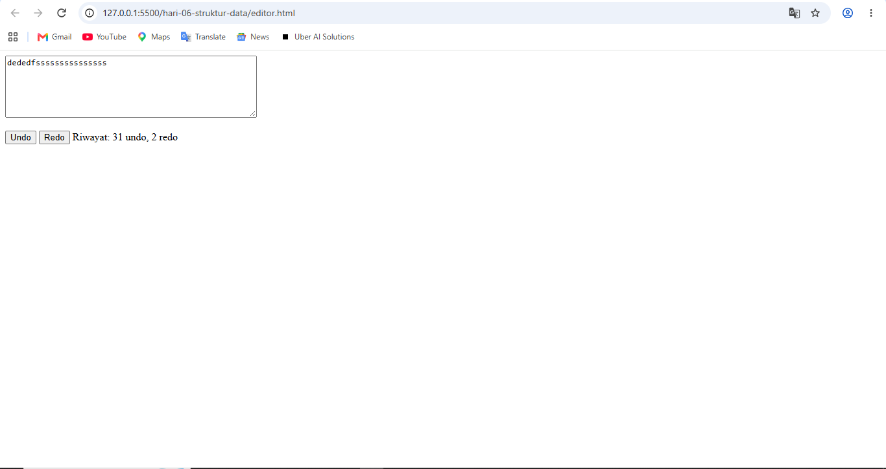
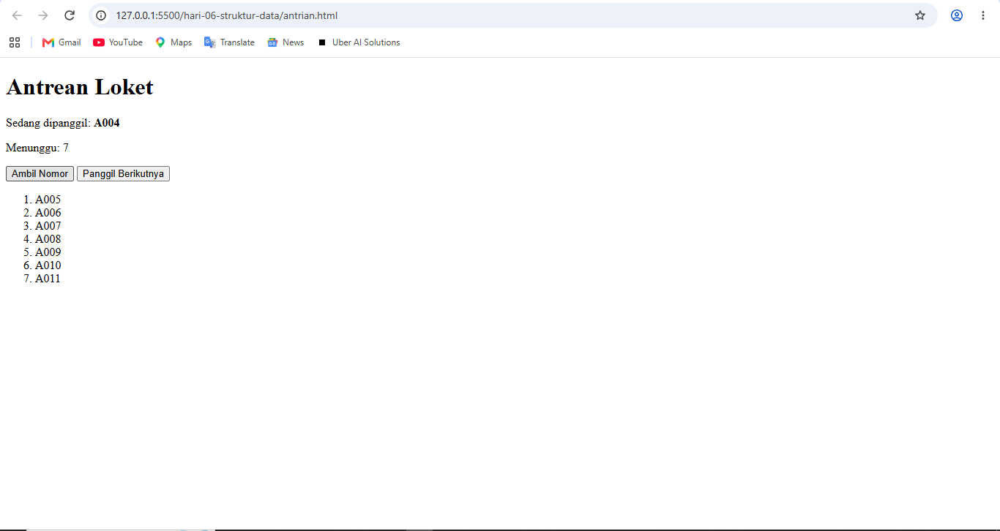
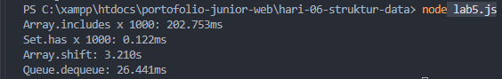
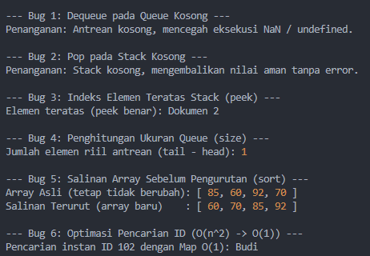

# Portofolio Hari 6 - Struktur Data I: Array, Objek, Stack, dan Queue
**Pelatihan Junior Web Programmer — Balai Diklat Industri Denpasar**  
**Unit Kompetensi**: J.620100.004.02 Menggunakan Struktur Data

---

## 📌 Ringkasan Pemenuhan Bukti Portofolio Hari 6

Berdasarkan modul pembelajaran Hari 6 (halaman 15), terdapat 4 bukti portofolio utama yang disajikan dalam dokumen ini:
1. **`structures.js`, `kurungSeimbang`, dan Hasil Uji** (Implementasi ADT Stack dan Queue dengan penanganan kasus tepi).
2. **Editor Undo/Redo serta Antrean Loket** (Mini-aplikasi bagian 1 Proyek 3 beserta tangkapan layar).
3. **Tabel Pengukuran Efisiensi (Lab 5) dan Dokumen Analisis Pemilihan Struktur Data** (Templat T7 untuk 3 studi kasus).
4. **Tabel Bug Hunt Hari 6 dan Berkas Demonstrasi Perbaikan (`bughunt.js`)**.

---

## 📁 1. Struktur Berkas Hari 6

Repositori Hari 6 tersusun secara modular menggunakan standar ES Module:

```text
hari-06-struktur-data/
├── structures.js            # Kelas data murni Stack (LIFO) dan Queue (FIFO O(1))
├── lab3.mjs                 # Uji Stack, validasi kurungSeimbang, & palindrom
├── lab4.js                  # Uji dasar operasi Queue
├── lab5.js                  # Skrip benchmark efisiensi waktu riil (Array vs Set, Array vs Queue)
├── label.js                 # Lab 1 & 2: Pemrosesan Array data peserta, Map, dan Set
├── bughunt.js               # Berkas implementasi dan demonstrasi penyelesaian 6 Bug Hunt
├── package.json             # Konfigurasi Node.js ("type": "module")
├── index.html               # Halaman uji Lab 3 via browser
├── antrian.html             # Mini-Aplikasi Antrean Loket (FIFO)
├── proyek3.html             # Mini-Aplikasi Editor Undo/Redo (Dua Stack)
├── js/
│   ├── antrian.js           # Pengendali DOM & event simulasi antrean loket
│   └── editor.js            # Pengendali DOM & event editor teks undo/redo
└── README.md                # Dokumentasi Utama Bukti Portofolio Hari 6
```

---

## 🧱 2. Bukti 1: `structures.js`, `kurungSeimbang`, dan Hasil Uji

### A. Implementasi ADT Stack dan Queue pada `structures.js`
Kelas struktur data dirancang secara terisolasi tanpa efek samping (*self-contained*) dan menangani kasus tepi (*edge cases*) seperti tumpukan/antrean kosong:

1. **Kelas `Stack` (LIFO - Last In, First Out)**:
   - `push(item)`: Menambahkan elemen ke puncak tumpukan ($O(1)$).
   - `pop()`: Mengambil dan menghapus elemen puncak tumpukan. Mengembalikan `undefined` dengan aman jika kosong ($O(1)$).
   - `peek()`: Mengintip elemen teratas menggunakan indeks `items[length - 1]` tanpa menghapusnya ($O(1)$).
   - `isEmpty()`: Memeriksa kekosongan tumpukan (`length === 0`).
   - `size()`: Mengembalikan jumlah elemen tersimpan.
   - `clear()`: Mengosongkan seluruh tumpukan.

2. **Kelas `Queue` (FIFO - First In, First Out) Berbasis Objek $O(1)$**:
   - Berbeda dengan `Array.shift()` yang berbiaya $O(n)$ karena menggeser seluruh elemen, kelas ini memanfaatkan penanda `head` dan `tail`:
   - `enqueue(item)`: Memasukkan elemen pada posisi `tail` lalu menaikkan pointer `tail` ($O(1)$).
   - `dequeue()`: Mengambil elemen pada posisi `head`, menghapus properti menggunakan operator `delete`, dan memajukan pointer `head` ($O(1)$).
   - `front()`: Mengintip elemen terdepan pada posisi `head` ($O(1)$).
   - `isEmpty()`: Mengembalikan `true` apabila `head === tail`.
   - `size()`: Menghitung selisih pointer `tail - head` ($O(1)$).

---

### B. Validasi Tanda Kurung Seimbang (`kurungSeimbang`) & Balik String
Fungsi `kurungSeimbang` memanfaatkan prinsip `Stack` untuk mencocokkan setiap kurung buka `(`, `[`, `{` dengan pasangan kurung tutupnya yang tepat `)`, `]`, `}`:

```javascript
import { Stack } from './structures.js';

export function kurungSeimbang(teks) {
  const pasangan = { ')': '(', ']': '[', '}': '{' };
  const tumpukan = new Stack();

  for (const karakter of teks) {
    if ('([{'.includes(karakter)) {
      tumpukan.push(karakter);
    } else if (karakter in pasangan) {
      if (tumpukan.isEmpty() || tumpukan.pop() !== pasangan[karakter]) {
        return false;
      }
    }
  }
  return tumpukan.isEmpty();
}
```

Hasil pengujian otomatis pada `lab3.mjs`:
* `kurungSeimbang('(a+b)*[c-d]')` $\rightarrow$ `true`
* `kurungSeimbang('(a+b]')` $\rightarrow$ `false` (tutup kurung siku tidak cocok dengan kurung bulat)
* `kurungSeimbang('((a)')` $\rightarrow$ `false` (kurung buka belum ditutup)
* `kurungSeimbang('')` $\rightarrow$ `true` (string kosong dianggap seimbang)
* Uji palindrom string: `"racecar"` $\rightarrow$ `true`, `"hello"` $\rightarrow$ `false`

### C. Tangkapan Layar Pengujian Bukti 1
Berikut adalah tangkapan layar eksekusi pengujian pada terminal:



---

## 🖥️ 3. Bukti 2: Mini-Aplikasi Undo/Redo dan Antrean Loket

### Bagian A: Editor Catatan Undo/Redo (`proyek3.html` & `js/editor.js`)
* **Arsitektur Dua Stack**: Menggunakan `undoStack` untuk menampung riwayat teks sebelumnya dan `redoStack` untuk menampung teks yang baru saja dibatalkan.
* **Perilaku Tombol**:
  * Mengetik input baru: Status saat ini disimpan ke `undoStack`, teks baru diperbarui, dan `redoStack` otomatis dikosongkan.
  * Klik `Undo`: Teks saat ini dipindahkan ke `redoStack`, dan teks terakhir ditarik dari `undoStack`.
  * Klik `Redo`: Teks saat ini dipindahkan ke `undoStack`, dan teks ditarik dari `redoStack`.
* **Kondisi Tombol**: Tombol dinonaktifkan (`disabled = true`) jika stack yang bersangkutan kosong (`isEmpty()`).



---

### Bagian B: Simulasi Antrean Loket (`antrian.html` & `js/antrian.js`)
* **Arsitektur FIFO $O(1)$**: Menggunakan `Queue` berbasis `head`/`tail` agar pemanggilan antrean cepat tanpa pergeseran memori.
* **Fitur Nomor Otomatis**: Menghasilkan kode antrean dengan padding 3 digit (contoh: `A001`, `A002`, `A003`).
* **Proteksi Antrean Kosong**: Apabila antrean habis, tampilan status menunjukkan pesan ramah `"Antrean kosong"`.



---

## ⏱️ 4. Bukti 3: Tabel Efisiensi (Lab 5) & Analisis Pemilihan Struktur Data

### A. Tabel Pengukuran Efisiensi Nyata (Uji Riil $N = 100.000$)

Pengujian dijalankan melalui berkas [**`lab5.js`**](file:///c:/xampp/htdocs/portofolio-junior-web/hari-06-struktur-data/lab5.js) dengan lingkungan Node.js pada dataset $N = 100.000$:

| Skenario Pengujian Operasi | Waktu Rata-rata (ms) | Kompleksitas Big-O | Analisis & Penjelasan Mengapa Berbeda |
| :--- | :---: | :---: | :--- |
| **`Array.includes` x 1000** | **202,753 ms** | $O(n)$ per pencarian | Array harus menelusuri elemen satu per satu dari awal sampai ujung akhir (*linear search*). |
| **`Set.has` x 1000** | **~0,122 ms** | $O(1)$ per pencarian | `Set` menggunakan tabel hash internal (*hash table*). Pencarian langsung menuju alamat memori nilai sehingga **$\pm$ 1.900x lebih cepat**. |
| **`Array.shift` hingga kosong** | **~3,210 s** | $O(n)$ per operasi ($O(n^2)$ total) | Setiap kali elemen terdepan dihapus, indeks dari seluruh elemen di belakangnya wajib digeser satu langkah ke kiri. |
| **`Queue.dequeue` hingga kosong** | **~26,441 ms** | $O(1)$ per operasi ($O(n)$ total) | Menggunakan penanda `head`, penghapusan hanya mengubah alamat penunjuk tanpa memindahkan posisi data lain. Hasilnya **$\pm$ 145x lebih cepat**. |



---

### B. Dokumen Analisis Pemilihan Struktur Data (Templat T7)

Berikut adalah analisis komparasi struktur data untuk tiga studi kasus nyata sesuai ketentuan modul:

#### Studi Kasus 1: Daftar Kontak Ponsel dengan Pencarian Nama
* **Deskripsi Masalah**: Aplikasi buku kontak menyimpan ribuan nomor telepon dan memerlukan fitur pencarian instan saat pengguna mengetikkan nama kontak.
* **Data**: Pasangan data kontak (nama, nomor HP, email), perkiraan 500 – 5.000 kontak.
* **Operasi Dominan**: Pencarian kontak berdasarkan nama (*lookup*), penambahan kontak baru, dan pengurutan alfabetis.
* **Alternatif Struktur Data**:
  1. *Array of Objects*: Pencarian nama berulang membutuhkan $O(n)$.
  2. *Map / Objek Hash*: Pencarian nama langsung dengan kunci $O(1)$.
  3. *Trie (Prefix Tree)*: Ideal untuk fitur pencarian awalan / *autocomplete* nama dengan kompleksitas $O(k)$ di mana $k$ adalah panjang karakter.
* **Perbandingan & Keputusan**:
  * Untuk kebutuhan pencarian cepat nama lengkap, struktur **`Map`** adalah pilihan terbaik karena memiliki waktu pencarian instan $O(1)$ rata-rata.
  * Jika aplikasi membutuhkan fitur *live autocomplete* (mengetik 2 huruf lalu muncul saran nama), struktur **Trie** dikombinasikan dengan **Map** menjadi pilihan optimal.

---

#### Studi Kasus 2: Riwayat Penelusuran Halaman Web (Tombol Back & Forward Browser)
* **Deskripsi Masalah**: Pengguna menjelajahi serangkaian URL web dan dapat menekan tombol *Back* (mundur) dan *Forward* (maju) secara berurutan.
* **Data**: URL halaman web (string), perkiraan 10 – 200 riwayat per sesi.
* **Operasi Dominan**: Menambah riwayat halaman baru, mengambil halaman terakhir dikunjungi, dan membalik arah navigasi.
* **Mengapa Menggunakan Stack?**:
  * Tombol *Back* bekerja berdasarkan prinsip **LIFO (Last In, First Out)**: Halaman yang paling terakhir dibuka adalah halaman pertama yang akan kembali ditampilkan saat menekan tombol mundur. Operasi `push()` dan `pop()` pada Stack membutuhkan waktu konstan $O(1)$.
* **Bagaimana Tombol Forward Bekerja?**:
  * Sistem browser menggunakan arsitektur **Dua Stack** (mirip fitur Undo/Redo):
    1. `BackStack`: Menampung riwayat URL mundur.
    2. `ForwardStack`: Menampung URL yang dilewati saat user menekan *Back*.
  * Ketika tombol *Back* ditekan, URL aktif saat ini dimasukkan ke `ForwardStack` (`push`), dan URL sebelumnya diambil dari `BackStack` (`pop`).
  * Jika user menekan *Forward*, URL ditarik dari `ForwardStack` dan dimasukkan kembali ke `BackStack`.
  * **Kasus Tepi**: Jika pengguna mengunjungi tautan/URL baru secara mandiri, maka seluruh isi `ForwardStack` wajib **dikosongkan (`clear()`)**.

---

#### Studi Kasus 3: Antrean Pasien Klinik dengan Kasus Gawat Darurat (Triage)
* **Deskripsi Masalah**: Pasien tiba di klinik dengan kondisi medis yang beragam. Pasien darurat/kritis (misal serangan jantung) harus ditangani segera tanpa menunggu giliran pasien biasa (misal flu ringan).
* **Data**: Objek pasien (ID, nama, tingkat kegawatan triage: Merah/Kuning/Hijau, waktu kedatangan).
* **Operasi Dominan**: Memasukkan pasien baru, memanggil pasien dengan kegawatan paling tinggi terlebih dahulu.
* **Mengapa Queue Biasa (FIFO) Tidak Cukup?**:
  * Queue standar bersifat *First In, First Out* murni (yang datang duluan dilayani duluan). Jika menggunakan Queue biasa, pasien darurat yang baru datang akan berada di urutan paling belakang, sehingga membahayakan keselamatan pasien.
* **Alternatif yang Dibutuhkan**:
  * Diperlukan struktur data **Priority Queue (Antrean Berprioritas)**, yang dapat diimplementasikan menggunakan:
    1. *Multi-Level Queue*: Memisahkan 3 antrean FIFO terpisah berdasarkan kategori triage (Prioritas 1: Darurat Merah, Prioritas 2: Mendesak Kuning, Prioritas 3: Normal Hijau). Dokter selalu menghabiskan antrean Merah sebelum berpindah ke Kuning.
    2. *Binary Heap (Min-Heap / Max-Heap)*: Elemen secara otomatis terurut berdasarkan bobot prioritas medis dalam waktu penyisipan $O(\log n)$ dan pengambilan pasien gawat darurat tercepat $O(1)$.

---

## 🐛 5. Bukti 4: Tabel Bug Hunt Hari 6 & Penyelesaian Kode

Berikut adalah klasifikasi 6 kesalahan umum manipulasi struktur data pada modul Hari 6 beserta pembuktiannya di berkas [**`bughunt.js`**](file:///c:/xampp/htdocs/portofolio-junior-web/hari-06-struktur-data/bughunt.js):

| No | Kode Bermasalah | Gejala yang Terjadi | Jenis Error | Penjelasan & Solusi Perbaikan |
| :---: | :--- | :--- | :---: | :--- |
| **1** | `dequeue()` pada queue kosong hasilnya langsung dipakai sebagai angka | Menghasilkan nilai `undefined` atau `NaN` pada kalkulasi/tampilan UI | **Logic Error** | Periksa selalu kondisi `isEmpty()` sebelum menggunakan nilai hasil `dequeue()`. |
| **2** | `pop()` stack kosong tanpa pemeriksaan | Nilai `undefined` merambat ke logika lain dan memicu `TypeError` | **Runtime / Logic Error** | Pastikan memeriksa `!stack.isEmpty()` atau kembalikan nilai aman default disertai pesan penanganan. |
| **3** | `peek()` memakai `items[items.length]` | Selalu mengembalikan `undefined` karena array JavaScript bersifat *0-indexed* | **Logic Error** | Gunakan indeks elemen terakhir yang sah: `items[items.length - 1]`. |
| **4** | `size()` pada Queue menghitung `tail + head` | Ukuran antrean salah dan terus membengkak | **Logic Error** | Penghitungan ukuran elemen riil antrean adalah selisih pointer: `tail - head`. |
| **5** | `const salinan = daftar; salinan.sort()` | Array asli ikut berubah urutannya karena variabel hanya menyalin referensi memori | **Logic Error** | Buat salinan array mandiri (*shallow copy*) menggunakan spread operator sebelum diurutkan: `[...daftar].sort(...)`. |
| **6** | Mencari ID dengan `.find()` di dalam loop 100.000 kali | Eksekusi sangat lambat dengan kompleksitas kuadratik $O(n^2)$ | **Performance / Logic Inefficiency** | Petakan data ke dalam `Map` atau objek berindeks ID satu kali ($O(n)$), sehingga pencarian selanjutnya berbiaya konstan $O(1)$. |

### Eksekusi Uji `bughunt.js`:
```bash
node bughunt.js
```



---