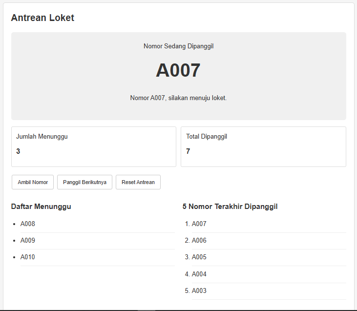
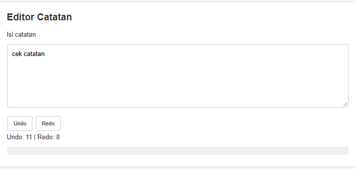

# PBL Hari 7 — Proyek 3: Simulator Antrean dan Riwayat

## 1. Deskripsi Proyek

Simulator Antrean dan Riwayat merupakan aplikasi berbasis web sederhana untuk membantu simulasi pengelolaan antrean pasien klinik dan pengeditan catatan dengan fitur Undo/Redo.

Proyek ini menerapkan struktur data **LinkedQueue, Stack, LinkedList, dan Array**, serta prinsip clean code menggunakan JavaScript ES Modules.

## 2. Fitur Aplikasi

### A. Antrean Loket
- Menghasilkan nomor antrean berurutan, mulai dari A001.
- Memanggil pasien berdasarkan prinsip FIFO (*First In, First Out*).
- Menampilkan jumlah dan daftar pasien yang sedang menunggu.
- Menampilkan lima nomor terakhir yang dipanggil.
- Melakukan reset antrean dengan konfirmasi.
- Menampilkan pesan ketika antrean kosong.

### B. Editor Catatan
- Mengedit catatan dengan fitur Undo dan Redo.
- Menggunakan dua Stack untuk menyimpan riwayat perubahan.
- Membatasi riwayat Undo maksimal 50 langkah.
- Menonaktifkan tombol Undo/Redo jika tidak tersedia riwayat.
- Menyimpan catatan terakhir menggunakan `localStorage`.

## 3. Struktur Folder

```text
proyek-3-antrian/
├── index.html
├── css/
│   └── style.css
├── js/
│   ├── structures.js
│   ├── antrian.js
│   ├── riwayat.js
│   └── app.js
└── README.md
```

## 4. Cara Menjalankan

1. Pastikan Visual Studio Code dan browser sudah tersedia.
2. Buka folder proyek `proyek-3-antrian` di Visual Studio Code.
3. Pasang ekstensi **Live Server** jika belum tersedia.
4. Klik kanan file `index.html`.
5. Pilih **Open with Live Server**.
6. Aplikasi akan terbuka di browser dan siap diuji.

Aplikasi menggunakan JavaScript ES Modules sehingga disarankan dijalankan melalui server lokal, bukan dengan membuka file HTML secara langsung.

## 5. Alasan Pemilihan Struktur Data

| Kebutuhan | Struktur dipilih | Alasan | Alternatif dan mengapa tidak dipilih |
|---|---|---|---|
| Antrean pasien | LinkedQueue | Operasi `enqueue` dan `dequeue` memiliki kompleksitas O(1), sehingga penambahan dan pengambilan pasien tidak perlu menggeser elemen. | Array dengan `shift()` memiliki kompleksitas O(n) karena elemen lainnya perlu digeser setelah elemen pertama dihapus. |
| Riwayat Undo/Redo | Stack | Mengikuti prinsip LIFO (*Last In, First Out*), sehingga perubahan terakhir dapat dibatalkan atau dikembalikan lebih dahulu. Dua Stack digunakan untuk memisahkan riwayat Undo dan Redo. | Queue mengikuti FIFO sehingga urutan pemrosesan perubahan tidak sesuai dengan kebutuhan Undo/Redo. |
| Lima panggilan terakhir | Array dengan batas panjang | Jumlah riwayat kecil dan tetap, serta mudah ditampilkan secara berurutan. | LinkedList dapat digunakan, tetapi berlebihan untuk riwayat yang hanya membutuhkan lima elemen. |

## 6. Kasus Uji Minimal

Pengujian dilakukan untuk memastikan seluruh fitur bekerja sesuai kebutuhan.

| No. | Skenario pengujian | Langkah pengujian | Hasil yang diharapkan |
|---|---|---|---|
| 1 | Mengambil nomor antrean | Klik Ambil Nomor sebanyak tiga kali. | Nomor A001, A002, dan A003 muncul berurutan dalam daftar menunggu. |
| 2 | Memanggil pasien | Klik Panggil Berikutnya sebanyak empat kali setelah mengambil tiga nomor. | Pemanggilan pertama sampai ketiga menghasilkan A001, A002, dan A003. Pemanggilan keempat menampilkan pesan antrean kosong. |
| 3 | Undo tiga kali | Buat beberapa perubahan catatan, kemudian klik Undo tiga kali. | Catatan kembali ke kondisi tiga perubahan sebelumnya. Tombol Undo/Redo mengikuti ketersediaan riwayat. |
| 4 | Redo dua kali | Setelah tiga kali Undo, klik Redo dua kali. | Dua perubahan terakhir yang dibatalkan diterapkan kembali. |
| 5 | Menghapus riwayat Redo | Lakukan Undo, kemudian ketik perubahan baru pada catatan. | Riwayat Redo dikosongkan dan tombol Redo menjadi nonaktif. |
| 6 | Reset antrean | Ambil beberapa nomor, klik Reset Antrean, lalu konfirmasi. | Daftar menunggu dan riwayat panggilan dikosongkan, jumlah antrean kembali nol, dan nomor berikutnya dimulai dari A001. |
| 7 | Reset dibatalkan | Ambil nomor, klik Reset Antrean, kemudian pilih Batal. | Data antrean tidak berubah. |
| 8 | Batas riwayat catatan | Lakukan lebih dari 50 perubahan catatan. | Riwayat Undo tidak melebihi 50 langkah. |
| 9 | Riwayat panggilan | Panggil lebih dari lima pasien. | Hanya lima nomor terakhir yang ditampilkan, dengan panggilan terbaru di urutan pertama. |

## 7. Tangkapan Layar

Tangkapan layar aplikasi yang sudah berjalan untuk menunjukkan hasil implementasi.

### A. Tampilan Antrean Pasien



Tangkapan layar memperlihatkan nomor yang sedang dipanggil, jumlah antrean, daftar pasien yang menunggu, serta lima nomor terakhir yang dipanggil.

### B. Tampilan Editor Catatan



Tangkapan layar memperlihatkan area editor catatan, tombol Undo/Redo, dan jumlah riwayat perubahan.

## 8. Teknologi yang Digunakan

- HTML
- CSS
- JavaScript
- Struktur data LinkedQueue, LinkedList, Stack, dan Array
- Browser `localStorage`
- Visual Studio Code dan Live Server

## 9. Kesimpulan

Proyek ini menerapkan struktur data sesuai karakteristik kebutuhan masing-masing fitur. LinkedQueue digunakan untuk antrean pasien, Stack untuk pengelolaan Undo/Redo, dan Array dengan batas panjang untuk menyimpan lima panggilan terakhir.

Penerapan pemisahan file, private field, JSDoc, penanganan kondisi kosong, serta pengujian fungsional membantu menghasilkan kode yang lebih terstruktur dan mudah dipelihara.
