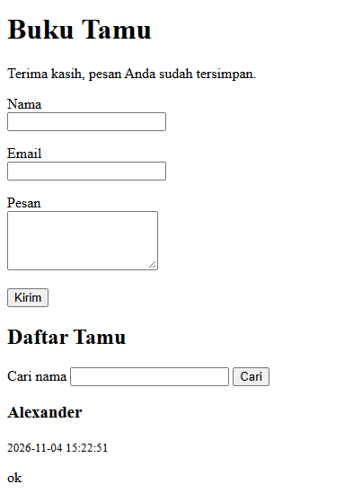
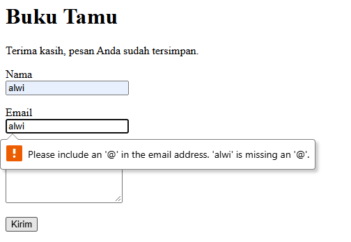
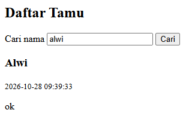
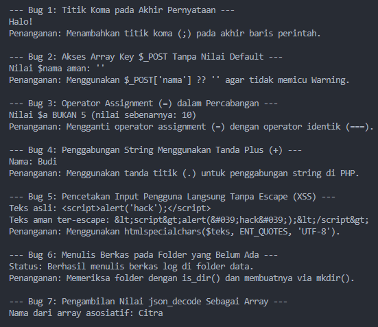

# Portofolio Hari 8 - PHP Terstruktur: Sintaks, Form, Validasi, dan Akses File (Proyek 4)
**Pelatihan Junior Web Programmer — Balai Diklat Industri Denpasar**  
**Unit Kompetensi**: J.620100.017.02 Mengimplementasikan Pemrograman Terstruktur (Versi PHP)

---

## 📌 Ringkasan Pemenuhan Bukti Portofolio Hari 8

Berdasarkan modul pembelajaran Hari 8 (halaman 16), terdapat 4 bukti portofolio utama yang disajikan dalam dokumen ini:
1. **Latihan Lab 1–4 di `hari-08-php/`** (PHP dasar, fungsi bertipe, form POST & validasi BMI, form GET, serta akses file teks/JSON/CSV).
2. **Proyek 4: Buku Tamu Berbasis File** lengkap dengan panduan alur dan tangkapan layar (form, galat validasi, daftar, pencarian).
3. **Tabel Bug Hunt Hari 8** (Klasifikasi 8 kesalahan umum pemrograman PHP, gejala, tipe error, dan solusinya).
4. **Bukti Uji Keamanan XSS (*Cross-Site Scripting*)**: Masukan skrip `<script>` berhasil di-escape dan tampil aman sebagai teks biasa.

---

## 📁 1. Struktur Berkas Hari 8

Repositori disusun rapi mengikuti kaidah pemisahan logika dan tampilan, serta standar PSR-12 dasar:

```text
hari-08-php/
├── berkas-dasar.php                 # Lab 1: Variabel, tipe data, perulangan, perkalian, match, date
├── lab2.php                         # Lab 2: Fungsi ber-DocBlock, array asosiatif, usort, tabel HTML
├── lab3.php                         # Lab 3: Form POST, validasi server, kalkulator BMI, escape XSS
├── bughunt.php                      # Demonstrasi penyelesaian 8 kasus Bug Hunt PHP
├── lab4/                            # Lab 4: Akses File & Form GET
│   ├── cari.php                     # Pencarian GET (stripos) & pencatatan log kunjungan
│   ├── lihat-log.php                # Menampilkan 20 baris log terakhir (file(), array_slice)
│   ├── json.php                     # Baca, ubah, dan simpan data array asosiatif ke JSON
│   ├── csv.php                      # Ekspor (fputcsv) & impor (fgetcsv) data peserta
│   └── data/
│       ├── log.txt                  # Catatan riwayat waktu, IP, dan kata kunci
│       ├── peserta.json             # Berkas data peserta format JSON
│       └── peserta.csv              # Berkas data peserta format CSV
├── proyek-4-buku-tamu/              # PBL Hari 8: Proyek 4 Buku Tamu Berbasis File
│   ├── index.php                    # Alur request, tampilan form, daftar tamu, pencarian
│   ├── functions.php                # Logika bisnis: validasiTamu, simpanTamu, ambilSemuaTamu, cariTamu
│   ├── README.md                    # Dokumentasi teknis khusus Proyek 4
│   └── data/
│       ├── .htaccess                # Proteksi keamanan: Require all denied
│       └── tamu.json                # Berkas penyimpanan JSON otomatis dengan LOCK_EX
└── README.md                        # Dokumentasi Utama Bukti Portofolio Hari 8
```

---

## 🧪 2. Bukti 1: Latihan Lab 1–4

### A. Lab 1 - PHP Dasar (`berkas-dasar.php`)
* Mendeklarasikan variabel nama, umur, dan status dengan `var_dump()` untuk memeriksa tipe data internal PHP.
* Menghasilkan tabel perkalian $10 \times 10$ menggunakan perulangan `for` bersarang.
* Menampilkan deret bilangan ganjil/genap (1–20), logika FizzBuzz (1–30), dan konversi nilai ke grade menggunakan ekspresi `match` (PHP 8).
* Menampilkan hari dan waktu server berbahasa Indonesia menggunakan array nama hari dan fungsi `date()`.

### B. Lab 2 - Fungsi dan Array Asosiatif (`lab2.php`)
* Menerapkan deklarasi ketat `declare(strict_types=1);` dan dokumentasi DocBlock standar.
* Fungsi murni bertipe:
  * `hitungRataRata(array $daftar): float`: Menghitung rata-rata nilai menggunakan `array_sum()` dan `count()`.
  * `cariTertinggi(array $daftar): ?array`: Menemukan peserta dengan skor nilai tertinggi.
  * `filterLulus(array $peserta, int $batas = 70): array`: Menyaring peserta menggunakan `array_filter()`.
  * `urutkanNilai(array $peserta): array`: Mengurutkan data secara menurun (*descending*) dengan `usort()` pada salinan data.
  * `kelompokkanPerKelas(array $peserta): array`: Mengelompokkan data berdasarkan kelas.
* Seluruh keluaran data pada tabel HTML diamankan menggunakan fungsi `htmlspecialchars()`.

### C. Lab 3 - Form POST dan Validasi Server: Kalkulator BMI (`lab3.php`)
* Memproses masukan form berat (kg) dan tinggi (cm) melalui metode `POST`.
* Validasi ketat di sisi server: memastikan input berupa numerik positif menggunakan `filter_var(..., FILTER_VALIDATE_FLOAT)`.
* Menghitung nilai BMI dan mengelompokkan kategori (`Kurang`, `Normal`, `Lebih`, `Obesitas`) dengan ekspresi `match`.
* Mencegah celah keamanan XSS pada nilai isian kembali (*repopulated input*) menggunakan `htmlspecialchars($nilai, ENT_QUOTES, 'UTF-8')`.

### D. Lab 4 - Form GET dan Akses File (`lab4/`)
* **Pencarian GET (`cari.php`)**: Menyaring data peserta berdasarkan sebagian nama menggunakan `stripos()` (tidak peka huruf besar-kecil).
* **Pencatatan Log (`cari.php` & `lihat-log.php`)**: Setiap pencarian mencatat waktu, IP pengunjung, dan kata kunci ke `data/log.txt` dengan mode `FILE_APPEND | LOCK_EX`. Berkas `lihat-log.php` menampilkan 20 riwayat terakhir menggunakan `array_slice(array_reverse(file(...)), 0, 20)`.
* **Pengolahan JSON (`json.php`)**: Membaca berkas dengan `json_decode($isi, true)`, memodifikasi data array, dan menyimpan kembali dengan format rapi `JSON_PRETTY_PRINT`.
* **Pengolahan CSV (`csv.php`)**: Menulis data menggunakan `fputcsv()` dan membaca kembali baris demi baris menggunakan `fgetcsv()`.
* **Penanganan Galat File**: Menggunakan `is_dir()` dan `mkdir($folder, 0777, true)` untuk memastikan folder penyimpanan selalu tersedia.

---

## 📖 3. Bukti 2: Proyek 4 - Buku Tamu Berbasis File

Proyek 4 adalah aplikasi web buku tamu tanpa basis data (*flat-file database*) yang memenuhi prinsip PSR-12 dan keamanan aplikasi web:

### A. Fitur & Arsitektur Utama
1. **Pola Post/Redirect/Get (PRG)**:
   * Setelah data form `POST` berhasil divalidasi dan disimpan, server merespons dengan pengalihan header:
     ```php
     header('Location: index.php?status=sukses');
     exit;
     ```
   * Pola ini mencegah terjadinya pengiriman ganda (*duplicate submission*) saat pengguna me-refresh halaman browser.
2. **Validasi Sisi Server Komprehensif & Retensi Nilai Lama**:
   * **Nama**: Dibersihkan dari spasi ganda via `preg_replace` dan minimal 3 karakter (`mb_strlen >= 3`).
   * **Email**: Wajib berformat email valid (`filter_var(..., FILTER_VALIDATE_EMAIL)`).
   * **Pesan**: Wajib diisi dan dibatasi maksimal 500 karakter.
   * Jika validasi gagal, form menampilkan pesan kesalahan spesifik tepat di bawah kolom terkait, dan nilai isian sebelumnya tetap dipertahankan (`$lama`).
3. **Penyimpanan Berkas JSON Aman (`LOCK_EX`)**:
   * Data tamu disimpan di `data/tamu.json` dengan identitas unik (`id`) otomatis bertambah dan cap waktu (`date('Y-m-d H:i:s')`).
   * Menggunakan penguncian berkas eksklusif `file_put_contents(FILE_TAMU, $json, LOCK_EX)` untuk mencegah korupsi data akibat penulisan bersamaan (*race condition*).
4. **Proteksi Direktori Data (`.htaccess`)**:
   * Direktori `data/` dilengkapi berkas `.htaccess` dengan aturan:
     ```apache
     Require all denied
     ```
   * Konfigurasi ini memblokir akses langsung pihak luar/browser ke berkas `tamu.json` demi melindungi privasi data pengunjung.
5. **Urutan Kronologis Mundur & Pencarian Nama**:
   * Daftar tamu ditampilkan dengan entri terbaru di urutan paling atas (`array_reverse`).
   * Form pencarian GET `q` menyaring tamu secara instan tanpa peka huruf besar-kecil (*case-insensitive*).

---

### B. Tangkapan Layar Proyek 4

* **1. Tampilan Form Buku Tamu (Kondisi Normal / Pengiriman Berhasil):**  
  

* **2. Tampilan Galat Validasi (Pesan Galat Merah & Nilai Lama Bertahan):**  
  

* **3. Tampilan Daftar Tamu (Pesan Terbaru Paling Atas):**  
  

* **4. Tampilan Hasil Pencarian Tamu Berdasarkan Nama:**  
  

---

## 🛡️ 4. Bukti 4: Bukti Pengujian Keamanan Anti-XSS (*Cross-Site Scripting*)

### A. Skenario Pengujian Injeksi
Untuk membuktikan ketahanan sistem terhadap serangan XSS, dilakukan pengujian dengan memasukkan kode skrip JavaScript berbahaya ke dalam kolom nama dan pesan:

* **Vektor Serangan (Payload XSS)**:
  ```html
  <script>alert('XSS Berbahaya!')</script>
  ```

### B. Mekanisme Pertahanan Kode
Pada `functions.php`, fungsi pembantu `e()` diimplementasikan untuk mengamankan seluruh teks sebelum dicetak ke browser:

```php
function e(string $teks): string
{
    return htmlspecialchars($teks, ENT_QUOTES, 'UTF-8');
}
```

Ketika teks dicetak ke template:
```php
<h3><?= e($tamu['nama']) ?></h3>
<p><?= nl2br(e($tamu['pesan'])) ?></p>
```

Karakter berbahaya diubah menjadi entitas HTML yang aman:
* `<` diubah menjadi `&lt;`
* `>` diubah menjadi `&gt;`
* `'` diubah menjadi `&#039;`
* `"` diubah menjadi `&quot;`

### C. Hasil Pengujian
* Browser **TIDAK mengeksekusi skrip popup alert**.
* Masukan skrip tampil utuh dan aman sebagai string teks biasa di layar pengguna.

<!--  -->

---

## 🐛 5. Bukti 3: Tabel Bug Hunt Hari 8

Tabel klasifikasi 8 kesalahan umum pemrograman PHP pada modul Hari 8 mencakup gejala yang dialami, jenis kesalahan, dan solusi perbaikannya:

| No | Kode Bermasalah | Gejala yang Terjadi | Jenis Error | Penjelasan & Solusi Perbaikan |
| :---: | :--- | :--- | :---: | :--- |
| **1** | `echo 'Halo'` tanpa titik koma di akhir | Muncul pesan `Parse error: syntax error, unexpected ...` | **Parse / Syntax Error** | Setiap akhir pernyataan tunggal di PHP wajib diakhiri tanda titik koma (`;`). |
| **2** | `$nama = $_POST['nama'];` saat halaman pertama kali dibuka | Muncul `Warning: Undefined array key "nama"` | **Runtime Warning** | Gunakan operator *null coalescing*: `$_POST['nama'] ?? ''` agar memiliki nilai bawaan saat form belum di-submit. |
| **3** | `if ($a = 5)` di dalam blok percabangan | Percabangan selalu bernilai benar (*true*) tanpa mempedulikan nilai awal `$a` | **Logic Error** | Tanda `=` adalah operator penugasan (*assignment*). Gunakan operator perbandingan identik `===`: `if ($a === 5)`. |
| **4** | `echo 'Nama: ' + $nama;` | Menghasilkan angka `0` atau memicu galat `TypeError` | **Type / Logic Error** | Tanda `+` di PHP hanya untuk penjumlahan aritmetika. Untuk menggabungkan string (*konkatenasi*), gunakan tanda titik (`.`): `'Nama: ' . $nama`. |
| **5** | `echo $_POST['pesan'];` langsung tanpa penyaringan | Celah keamanan **Cross-Site Scripting (XSS)** terbuka lebar | **Security Vulnerability** | Selalu escape karakter berbahaya sebelum mencetak ke HTML menggunakan `htmlspecialchars($_POST['pesan'], ENT_QUOTES, 'UTF-8')`. |
| **6** | `file_put_contents('data/log.txt', ...)` sementara folder `data/` belum dibuat | Muncul `Warning: failed to open stream: No such file or directory` | **Runtime / I/O Error** | Pastikan folder tujuan telah dibuat terlebih dahulu menggunakan `if (!is_dir($folder)) mkdir($folder, 0755, true);`. |
| **7** | `json_decode($isi)` tanpa argumen `true` lalu mengakses `$d['nama']` | Muncul `Fatal error: Cannot use object of type stdClass as array` | **Runtime / Type Error** | Secara bawaan `json_decode` menghasilkan objek `stdClass`. Berikan argumen boolean `true` pada parameter kedua: `json_decode($isi, true)` agar menjadi array asosiatif. |
| **8** | `header('Location: ...')` dipanggil setelah ada output tag HTML/spasi | Muncul `Warning: Cannot modify header information - headers already sent` | **Runtime Warning** | Header HTTP wajib dikirim sebelum ada teks, spasi, atau tag HTML apa pun yang dikirim ke browser. Panggil `header(...)` di baris teratas lalu sertakan `exit;`. |

### Eksekusi Uji `bughunt.php`:
```bash
php bughunt.php
```



---
