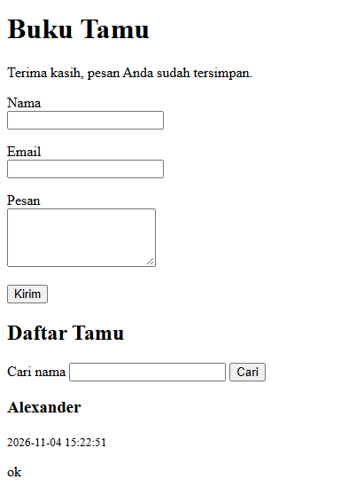
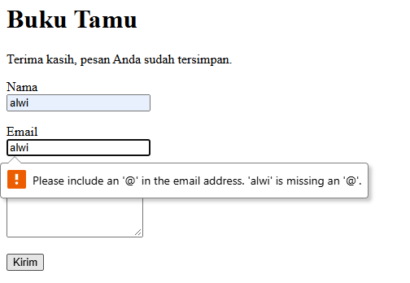
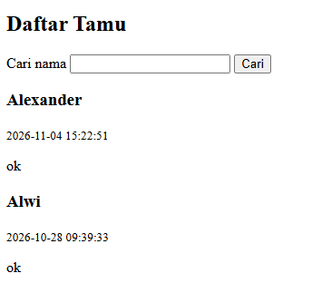
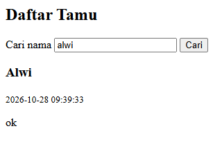

# Proyek 4: Buku Tamu Berbasis File

Proyek ini merupakan implementasi **Project-Based Learning (PBL)** Hari ke-8 pada Pelatihan Junior Web Programmer (Balai Diklat Industri Denpasar) yang berfokus pada:
1. Pemisahan berkas logika bisnis (*functions*) dan antarmuka tampilan (*presentation*).
2. Penerapan pola navigasi **Post/Redirect/Get (PRG)** untuk mencegah pengiriman ulang form saat halaman disegarkan.
3. Validasi ketat di sisi server (*server-side validation*) dengan mempertahankan data lama (*old input*).
4. Penyimpanan persisten berbasis berkas JSON dengan penguncian eksklusif (`LOCK_EX`).
5. Keamanan aplikasi web: pencegahan celah **Cross-Site Scripting (XSS)** dan proteksi berkas melalui **`.htaccess`**.

---

## 📁 Struktur Berkas Proyek

```text
proyek-4-buku-tamu/
├── index.php            # Tampilan HTML, form masukan, daftar tamu, dan form pencarian
├── functions.php        # Logika: validasiTamu, simpanTamu, ambilSemuaTamu, cariTamu, sanitasi e()
├── data/
│   ├── .htaccess        # Konfigurasi proteksi: Require all denied
│   └── tamu.json        # Berkas data JSON yang dibuat dan dikelola otomatis
└── README.md            # Dokumentasi Proyek 4 Buku Tamu
```

---

## ⚙️ Fitur Utama & Spesifikasi Teknis

### 1. Pola Post/Redirect/Get (PRG)
Ketika pengguna mengirimkan data melalui form `POST` dan seluruh validasi terpenuhi, sistem tidak langsung merender HTML, melainkan mengalihkan browser ke halaman status sukses:
```php
header('Location: index.php?status=sukses');
exit;
```
Hal ini menjamin pengguna tidak akan mengirimkan data ganda jika mereka menekan tombol *refresh* (F5).

### 2. Validasi Input & Pencegahan Galat
* **Nama**: Wajib diisi, spasi ganda dihapus (`preg_replace`), minimal 3 karakter.
* **Email**: Diuji menggunakan `filter_var(..., FILTER_VALIDATE_EMAIL)`.
* **Pesan**: Wajib diisi dan dibatasi maksimal 500 karakter.
* Jika ada isian yang tidak memenuhi syarat, pesan galat spesifik dimunculkan di bawah kolom terkait, dan nilai input yang sudah diketik tetap dipertahankan (`$lama`).

### 3. Keamanan Anti-XSS (Cross-Site Scripting)
Seluruh pencetakan data dari pengguna ke layar HTML wajib melewati fungsi sanitasi:
```php
function e(string $teks): string
{
    return htmlspecialchars($teks, ENT_QUOTES, 'UTF-8');
}
```
Karakter khusus seperti `<`, `>`, `'`, dan `"` dikonversi ke entitas HTML sehingga skrip jahat (contoh: `<script>alert('xss')</script>`) tidak dapat dieksekusi di browser.

### 4. Penyimpanan JSON & Kunci Berkas (`LOCK_EX`)
Data disimpan dalam bentuk JSON terstruktur di `data/tamu.json`. Setiap penulisan menggunakan flag `LOCK_EX` untuk mengunci berkas sementara saat proses penulisan berlangsung, mencegah kerusakan data (*data corruption*) akibat request bersamaan.

### 5. Perlindungan Folder Data (`.htaccess`)
Berkas `.htaccess` diletakkan di dalam folder `data/` dengan isi:
```apache
Require all denied
```
Konfigurasi ini memastikan bahwa siapa pun yang mencoba mengakses berkas data secara langsung via URL browser (misal: `http://localhost/.../data/tamu.json`) akan ditolak dengan respons **403 Forbidden**.

---

## 🚀 Panduan Menjalankan

Aplikasi ini berjalan di lingkungan web server lokal (Apache / XAMPP):
1. Pastikan modul **Apache** pada panel kontrol XAMPP berstatus aktif (*Running*).
2. Letakkan proyek di direktori web root XAMPP (`htdocs`).
3. Buka browser dan akses alamat berikut:
   ```text
   http://localhost/portofolio-junior-web/hari-08-php/proyek-4-buku-tamu/index.php
   ```

---

## 🖼️ Tangkapan Layar Bukti Pengujian

* **1. Form Buku Tamu Normal & Notifikasi Sukses:**  
  

* **2. Galat Validasi Input:**  
  

* **3. Daftar Tamu (Terurut Kronologis Mundur):**  
  

* **4. Hasil Pencarian Nama Tamu (`?q=...`):**  
  

<!-- * **5. Pengujian Keamanan Anti-XSS (`<script>` Tampil Sebagai Teks):**  
   -->

